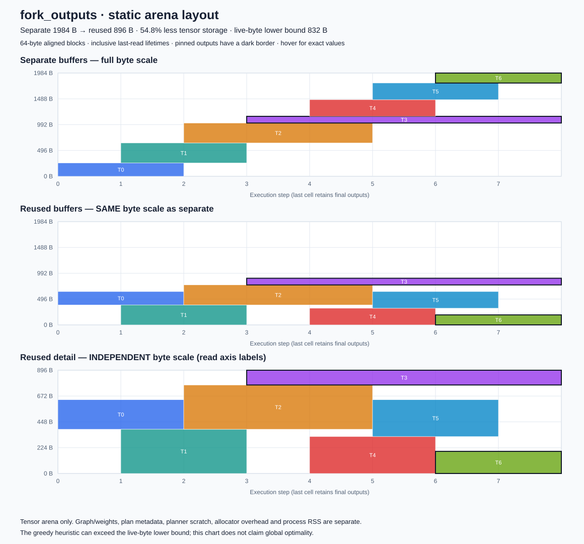

# Tiny Arena Lab

A small C11 inference memory planner with real graph execution, independent
correctness checks, measured planning cost and visualized tensor allocations.

It compares two layouts of the **same graph, schedule, inputs, weights and kernels**:

- **Separate:** every tensor has its own aligned arena region, retained for the run.
- **Reuse:** a descending-size greedy planner shares regions only when inclusive
  lifetimes do not overlap. Final outputs stay pinned through graph completion.

Both use one caller-owned arena. The baseline does not perform a heap allocation
per tensor or per operation. No in-place operations or dead-code elimination are
used to give reuse extra computational advantages.

## Quick start

Requires a C11 compiler, Make, Git and Python 3.9+. Tested platforms are macOS and
Linux; default tests and tools use only the Python standard library.

```sh
make test sanitize mutation
make publication-check
# Requires committed measurement sources; writes ignored local evidence.
python3 tools/run_benchmark.py --output results/local/my-run
python3 tools/verify_report.py results/local/my-run
```

Open `results/local/my-run/visualization/index.html` in a browser for allocation
diagrams, or view individual SVGs. First two panels use the same byte scale;
the third zooms the reused arena and labels its independent scale.

## Supported MVP

Static float32 DAGs, up to 128 tensors, fixed topological order, multiple input
arrays and multiple outputs. Operators: dense + bias, ReLU and elementwise Add.
Inputs are copied into the arena under both layouts; constant weights/bias and
graph descriptions remain external. The core has no direct heap allocator
references; the host test/benchmark fixtures allocate outside timed planning.

Measured graphs cover a chain, residual branch, two pinned fork outputs with
non-aligned logical tensor lengths, and a 65-tensor residual stack. Tests also
check 100 varied DAGs, maximum graph capacity, actual intermediate addresses and
every produced tensor against a separate Python float64 `math.fsum` reference.

The planner is a heuristic. The peak sum of simultaneously live padded blocks is
a **lower bound**, not proof an equally small static layout exists. The selected
fork and residual-stack examples preserve visible gaps above that bound.

## Measurements

Measured source: `b149010`, Apple M5 Pro, Darwin 27 arm64, Apple Clang 21.0.0.
Each of six fresh processes measures 20 groups of 1,024 complete plans per mode
and graph, after warmup. Times below are medians of process medians; raw samples
and process ranges are in the [measurement manifest](results/published/host-20261014/manifest.json).

| Graph | Separate arena (B) | Reused arena (B) | Live lower bound (B) | Separate plan (µs) | Reuse plan (µs) |
| --- | ---: | ---: | ---: | ---: | ---: |
| chain | 1920 | 768 | 768 | 0.172 | 0.211 |
| residual | 4352 | 2560 | 2560 | 0.127 | 0.159 |
| fork_outputs | 1984 | 896 | 832 | 0.126 | 0.167 |
| residual_stack | 12416 | 768 | 640 | 5.147 | 6.950 |

Reuse saves tensor storage on these graphs and costs more planning time. Both
modes also require **4128 B of plan metadata** and **4096 B of explicit scratch**
on this host. Those fixed costs do not shrink with the arena. Neither the arena
table nor arena + metadata + scratch represents whole-process memory usage.
The heuristic does not reach the live-byte lower bound on every graph.

The first measured process also records actual guarded allocation requests and
host allocator usable sizes below. Requests include 128 B of boundary guards;
usable size can exceed the request. These figures exclude plan/scratch, weights
and host fixture storage, and are not RSS. All processes retain their own records.

| Allocation graph | Separate request (B) | Separate usable (B) | Reuse request (B) | Reuse usable (B) |
| --- | ---: | ---: | ---: | ---: |
| chain | 2048 | 2048 | 896 | 896 |
| residual | 4480 | 5120 | 2688 | 3072 |
| fork_outputs | 2112 | 2560 | 1024 | 1024 |
| residual_stack | 12544 | 14336 | 896 | 896 |

[Correctness evidence](results/published/host-20261014/correctness.json) includes
every actual intermediate and final output. The [allocation viewer](docs/figures/index.html)
can be downloaded with its SVG files and opened locally; GitHub displays the HTML
source. Individual SVGs can be viewed directly. The first two panels share a byte
scale; the third explicitly zooms reused storage. Hover a block for its exact
tensor, lifetime, offset and padded size. Dark borders mark pinned outputs.



## What memory and time mean

Arena bytes are actual reserved tensor storage including 64-byte alignment/padding.
The C harness allocates each reported arena, checks actual tensor addresses and
boundary guards, reads every final output, and records requested/allocator-usable
allocation bytes. Allocation requests include two 64-byte guard regions, reported
separately. A zero usable-size field means the host has no supported usable-size API.

Plan metadata and explicit planning scratch are reported separately. Execution
also validates the plan with one scratch object on the stack. Adding arena + plan
+ explicit scratch is an accounting subtotal, not full process RAM. Graphs,
weights, external inputs, other stack frames, runtime/allocator overhead and host
fixture scaffolding are excluded from that subtotal. No process-RSS or MCU-RAM
reduction is claimed.

Planning time is measured inside C with `CLOCK_MONOTONIC`, over repeated complete
plan builds including graph/lifetime validation, placement, final validation,
loop and volatile-sink overhead. Python overhead, arena allocation, inference,
observation callbacks, verification and rendering are outside these intervals.
Raw samples retain timer resolution. Six processes use rotating graph order and
alternating mode order; summaries are medians of process medians and ranges.
These are group-average plan costs, not single-call tail percentiles.

## Correctness and evidence

- Hand-derived outputs, inclusive consumption boundaries and pinned outputs.
- Invalid graphs/counts, integer overflow, capacities, misalignment, aliases,
  non-finite inputs/results and stale/corrupted plan checks.
- Every intermediate tensor is observed in the actual C executor and compared
  to the independent oracle; both plans must produce identical final outputs.
- ASan/UBSan on production sources. Object-symbol checks for allocator references.
- Compiled wrong lifetime, missing output pin and missing ReLU implementations
  are rejected by native validation or independent lifetime/numerical checks.
- Normal Python and `python -O`; raw-report corruption fixtures recompute hashes
  so semantic validation must catch the substituted data.
- Archived source/object/library/executable hashes and exact compiler/link flags.

See [contribution guidance](CONTRIBUTING.md). Personal configuration, credentials,
local experiments and compiled binaries stay outside Git. A targeted publication
guard is not an exhaustive secret detector.

## Limits and license

This is a host-side engineering experiment with synthetic graphs. It is not an
ONNX importer, production inference framework, optimal solver or MCU hardware
validation. Smaller tensor storage does not imply faster inference or lower
whole-process RAM. Planner cost is a separate trade-off and may be paid once per
static graph. Public pointers/counts must be valid and borrowed data immutable;
the C API cannot establish arbitrary pointer validity.

Project code and documentation use the [MIT License](LICENSE).
