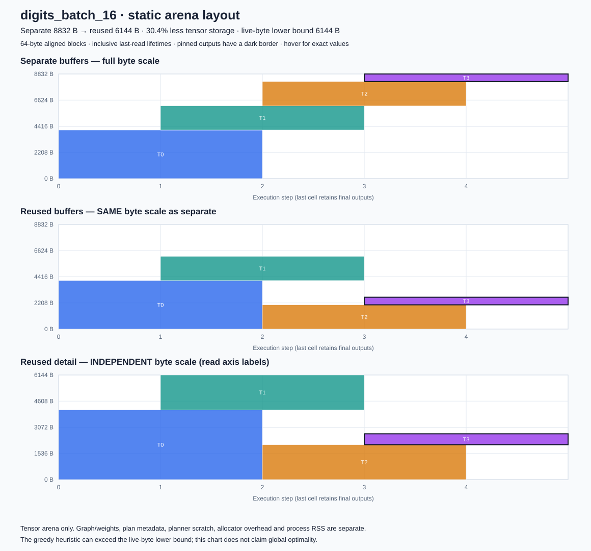

# Real digits model under a tensor-arena budget

A trained 64→32→10 float32 ReLU MLP recognizes 8×8 handwritten digits using the
unchanged production graph/planner/executor. The final tensor contains ten logits;
argmax gives the class without an added softmax operator. Same weights, inputs,
batch size, graph order and kernels are used for both layouts.

## Reproduce

Default correctness tests, generation and measurements require only Python 3.9+,
Git and a C11 compiler. Run from the repository root:

```sh
python3 examples/digits/run.py test
python3 examples/digits/run.py sanitize
# Commit all measurement sources first; output directory must not exist.
python3 examples/digits/run.py measure --output results/local/my-digits
python3 examples/digits/verify.py results/local/my-digits
python3 examples/digits/verify.py results/published/digits-budget-reviewed-20261014 --docs
```

Optional independent dataset/sklearn check (no training):

```sh
python3 -m venv build/digits-reference-env
build/digits-reference-env/bin/python -m pip install -r examples/digits/requirements.txt
build/digits-reference-env/bin/python examples/digits/prepare.py --check
```

## Model, split and accuracy policy

The committed model is reused unchanged from tiny-infer-lab; see [provenance,
licenses and dataset attribution](NOTICE.md). The original training used only
1,347 training images, fixed pixel/16 normalization, seed 20261014, Adam and
training-loss convergence, with no test-set early stopping or parameter search.
The installed sklearn check also verifies the full recorded training policy.
Its recorded 450 test images have already been evaluated by the upstream project;
this experiment checks transfer into this engine, not a newly unseen accuracy
benchmark. The existing 94% accuracy floor is preserved, not tuned here.

`prepare.py --check` loads the installed sklearn dataset, checks its full canonical
hash, reproduces the stratified index split, checks exact duplicate images across
train/test, restores the recorded float32 weights into sklearn's documented MLP
attributes, and compares predict_proba to the original trained model export.
It exports NumPy logits and sklearn classes for all test rows. It does not fit.
Normal tests audit disjoint/complete indices, training-image hashes, artifact
hashes, the exact C input/label arrays and every C parameter, then check every intermediate against independent
Python float64 fsum and final logits/classes against those references. Both
layouts must agree bitwise at every intermediate. No Python pickle is loaded.

## Budget and memory meaning

Predefined payload budgets are **512 B at batch 1** and **7,168 B (7 KiB) at batch
16**. They are experiment settings selected to demonstrate the layout difference,
not limits measured on a physical device. The C harness actually allocates a
budget-sized payload plus two 64-byte redzones and supplies exactly that payload
capacity to `ta_run`. Separate must return TA_CAPACITY before any observer call or
write; reuse must execute the entire test set in the same capacity. Every reuse
budget output must be bitwise equal to its adequately allocated counterpart.

A separate observation allocates each layout's own required arena, records actual
requested and native allocator usable bytes, and checks both boundary guards.
The 128 redzone bytes are test overhead; allocator rounding is reported, not
hidden inside a claimed payload budget. These are actual allocation observations,
not process RSS or an enforced whole-process RAM ceiling.

The **accounted storage subtotal** includes one arena, one plan, one explicit
scratch object, float32 weights/bias, graph descriptors/output ID, and one active
external float32 input batch. Planning scratch and execution validation scratch
are alternative phases in that accounting. It excludes other stack frames,
pointer/count variables, alignment of separate metadata objects, allocator
metadata/rounding, code/runtime, test dataset/reference arrays, output capture,
the other comparison's plan/arena and Python. The harness retains extra test
objects; its process RAM is intentionally not equated with a deployment budget.

Batch 16 always executes 16 rows: the last batch has two valid rows plus 14 zero
rows. All 450 real rows are scored exactly once, 464 rows are computed, and both
layouts pay that padding cost. The output tensor is reused only after its valid
rows have been consumed. Input normalization is fixed and prepared outside timing.

## Selected measurements

Measured source `edfce00`, Apple M5 Pro / Darwin 27 arm64 / Apple Clang 21.0.0.
Six fresh processes, eleven sample groups per process. Accuracy is **438/450
(97.33%)** for both layouts and batch sizes, matching sklearn classes.

| Batch | Arena budget (B) | Separate arena (B) | Reused arena (B) | Separate accounted (B) | Reuse accounted (B) | Correct |
| --- | ---: | ---: | ---: | ---: | ---: | --- |
| 1 | 512 | 576 | 384 | 19024 | 18832 | 438/450 |
| 16 | 7168 | 8832 | 6144 | 31120 | 28432 | 438/450 |

Separate returns TA_CAPACITY under each arena budget; reuse completes all examples.
The corresponding accounted-storage budgets (fixed storage + arena budget) are
18,960 B at batch 1 and 29,456 B at batch 16; separate exceeds them and reuse fits.
These remain accounting subtotals, not measured total RAM ceilings.

Actual first-process native allocations, including 128 B of test redzones:

| Allocation batch | Separate request (B) | Separate usable (B) | Reuse request (B) | Reuse usable (B) | Budget request (B) | Budget usable (B) |
| --- | ---: | ---: | ---: | ---: | ---: | ---: |
| 1 | 704 | 768 | 512 | 512 | 640 | 640 |
| 16 | 8960 | 10240 | 6272 | 7168 | 7296 | 8192 |

For example, the 7-KiB payload limit does not mean malloc consumes only 7 KiB;
its guarded request and allocator usable bytes are shown explicitly above. The
capacity supplied to the executor is always exactly the stated payload budget.

Median of process medians; planning is µs per complete build, inference is µs per
valid example in a full-test pass (including final-batch padding):

| Timing batch | Separate plan (µs) | Reuse plan (µs) | Separate infer (µs/example) | Reuse infer (µs/example) |
| --- | ---: | ---: | ---: | ---: |
| 1 | 0.078 | 0.083 | 0.701 | 0.701 |
| 16 | 0.078 | 0.082 | 0.677 | 0.684 |

Process ranges overlap; these observations demonstrate budget feasibility, not a
reliable inference speedup. Small planning differences are near host timing
variation. Exact samples, clock resolution and process ranges are retained in
the [manifest](../../results/published/digits-budget-reviewed-20261014/manifest.json);
[correctness evidence](../../results/published/digits-budget-reviewed-20261014/correctness.json)
includes every intermediate, actual address offsets and all 450 final logits.



The [batch 1 diagram](batch-1.svg) is also available. These diagrams show tensor
arena storage only, with the first two panels sharing the same byte scale.

The [review](REVIEW.md) documents the timed-path validation gap and its compiled
regression tests. The original v1 [measurement archive](../../results/published/digits-budget-20261014/manifest.json)
retains source `edfce00`; v2 includes fingerprint/counter work and supersedes its
current timing claims. Results across these protocols are not a speed comparison.

## Timing interpretation

Real CLOCK_MONOTONIC intervals inside C measure two distinct quantities:

- Full plan construction, including analysis, placement and validation, over
  1,024 repetitions per group, with status/loop/volatile-sink overhead.
- Warm full-test passes with prebuilt plans, four passes per group, normalized by
  450 valid examples. Includes packing, zero-padding, input copying, per-inference
  plan validation, numerical checks, dense/ReLU kernels, argmax, work counters and
  a fingerprint of every valid row index, class and all ten float32 logits.
  Excludes normalization, allocation, Python, observers, output capture and JSON.

Separate's inference timing uses an adequately sized arena. Its capacity rejection
under the smaller budget is not timed as successful inference. Raw records rotate
batch order across processes and alternate mode order across sample groups; kinds
are measured in fixed plan-then-inference order. Both modes are warmed up. No CPU
affinity or frequency isolation is imposed. Process ranges are observed variation,
not confidence intervals, and these host timings are not MCU performance claims.
Correctness is checked with observation enabled; actual C benchmark passes have no
observer. Every timed NULL-output pass must match the captured reference pass in
row/call counts, accuracy and its output fingerprint. Those comparisons occur
after the timer stops; fingerprint calculation and counter updates are timed.
Raw inference groups record four verified passes, 1,800 valid rows and the actual
kernel-call count; planning groups record 1,024 completed builds. Raw logits, labels, coverage, actual intermediate/address records,
allocator observations, source/build hashes and unrounded timings accompany results.
